<div align="center">


# Flyleaf

**Your self-hosted library for books, manga and comics — with a beautiful Material 3 reader that works in any browser and installs like an app on your iPhone.**


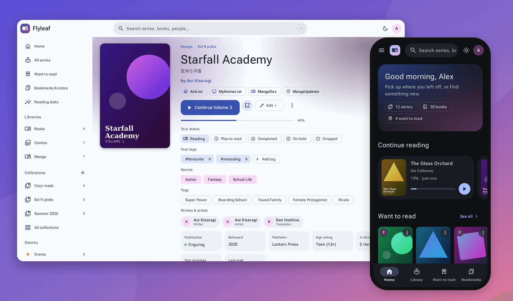

</div>

---

## ✨ Features

<table>
<tr>
<td width="50%" valign="top">

### 📚 Every format you own
- **Ebooks:** EPUB · KEPUB · MOBI · AZW · AZW3 · FB2 · TXT · PDF
- **Comics & manga:** CBZ · ZIP · CBR · RAR · CB7 · 7Z · CBT · TAR · plain image folders
- Archives are identified by their *contents*, so a `.cbr` that's really a zip still works
- Reads **ComicInfo.xml**, EPUB/Calibre metadata, MOBI EXTH and FB2 headers

### 📖 Readers built for reading
- **Manga & comics:** single page, **dual-page spreads**, **webtoon / continuous scroll**, **right-to-left**, fit screen/width/height/original, **page splitting** for double-page scans, custom background colour
- **Ebooks:** paginated or scrolling, 1–2 columns, themes (Paper, Sepia, Dark, OLED Black), **font family**, size, line spacing, margins, justification & hyphenation
- **Tap to paginate**, swipe, **immersive mode**, **auto-close menu**, fully **customisable key binds**
- **Reading profiles** – save a set of reader settings and assign it to libraries or series

### ✍️ Built-in annotations
- **Highlights** in five colours plus underline, with **notes**
- **Bookmarks** for any page in any format
- A **Bookmarks & notes** page that gathers everything across your library

</td>
<td width="50%" valign="top">

### 🗂️ Organised your way
- Choose **Kavita-style** (series from file names & metadata) or **Komga-style** (every folder is a series) per library
- **Want to read**, **custom collections**, personal **reading status** & **tags**, **genres**, people pages
- **Related series** (sequels, spin-offs…), age ratings, publication status

### 🔎 Metadata & artwork
- Scrape from **AniList · MangaDex · MyAnimeList · MangaUpdates · ComicVine · Open Library · Google Books**
- Optional **automatic matching** of new series, including artwork
- Full **metadata editor** – titles, summary, genres, tags, writers & artists, links to MAL/AniList and others, custom artwork
- **Blur artwork** per series for NSFW covers (and auto-blur 18+)

### 🌐 Share & sync
- **Admin + read-only guest accounts** – share over the internet with port forwarding
- Per-user **progress, resume, reading time & stats**, **age restrictions**
- **OPDS 1.2 + OPDS-PSE** for Panels, Chunky, KOReader, Moon+ … with progress sync
- **Send to Kindle / Kobo** by email, download single books or whole series

### 🎨 Feels like an app
- Material 3 throughout: **9 themes** + any custom colour, light/dark/auto
- **Colorscape** – series pages tint themselves from their artwork
- Smooth **page transitions & animations** (or turn them off)
- **iPhone/Android web app** – full-screen, home-screen icon, safe-area aware

</td>
</tr>
</table>

---

## 📸 Screenshots

<table>
<tr>
<td colspan="2"><p align="center"><b>Home</b> – continue reading, want to read, collections & genres in the drawer</p></td>
</tr>
<tr>
<td width="50%">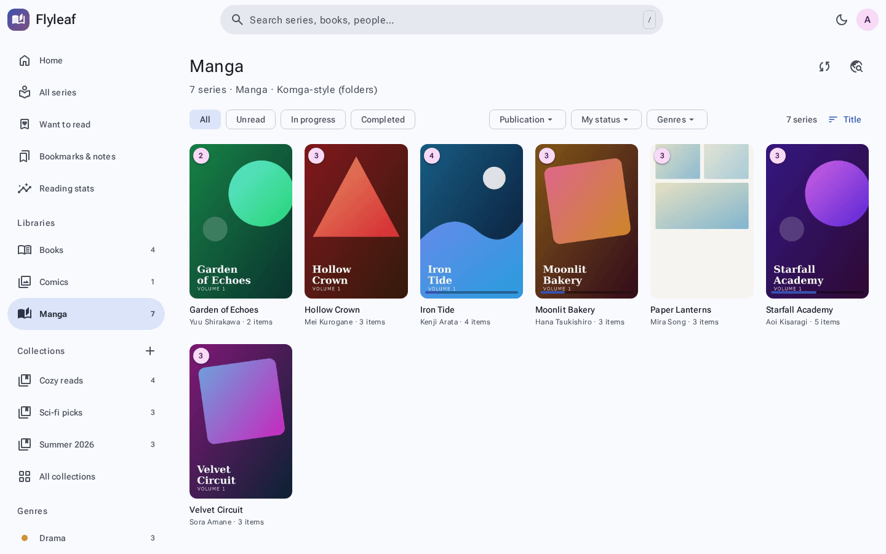<p align="center"><b>Library</b> – filters, genres, sort, ⋮ actions on every card</p></td>
<td width="50%">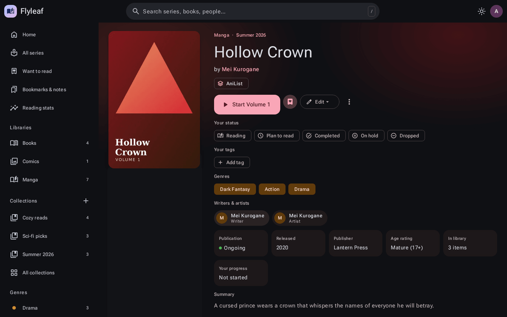<p align="center"><b>Series overview</b> – artwork, creators, links, status, tags, volumes</p></td>
</tr>
<tr>
<td>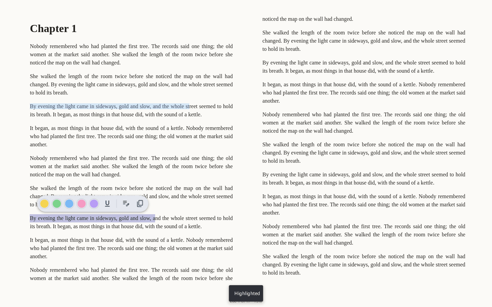<p align="center"><b>Ebook reader</b> – highlights, notes & a selection toolbar</p></td>
<td>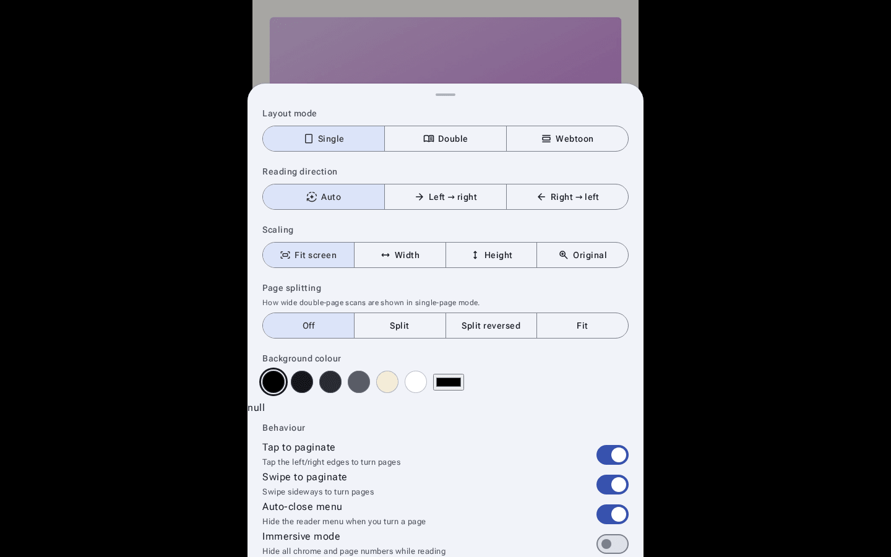<p align="center"><b>Manga reader</b> – layout, direction, scaling, page splitting</p></td>
</tr>
<tr>
<td>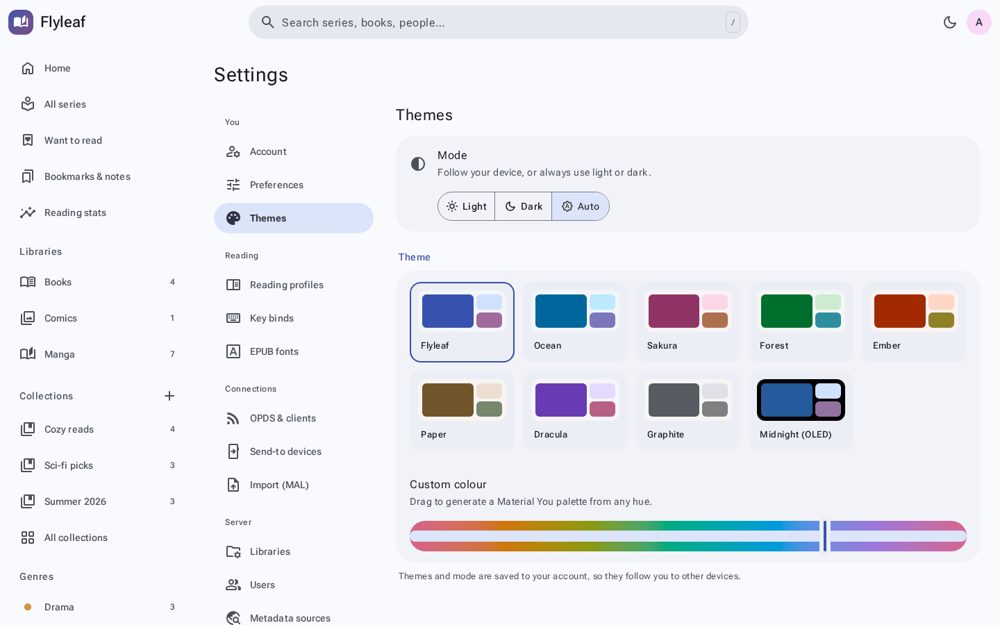<p align="center"><b>Themes</b> – presets or any colour you like</p></td>
<td>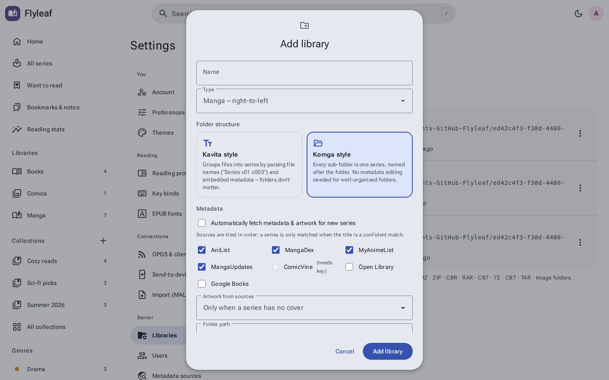<p align="center"><b>Add library</b> – Kavita or Komga folder structure</p></td>
</tr>
</table>

<table>
<tr>
<td>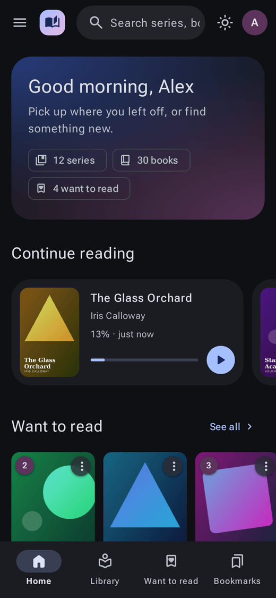</td>
<td>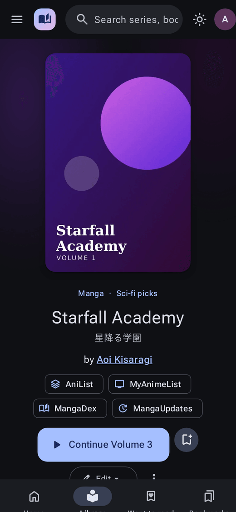</td>
<td>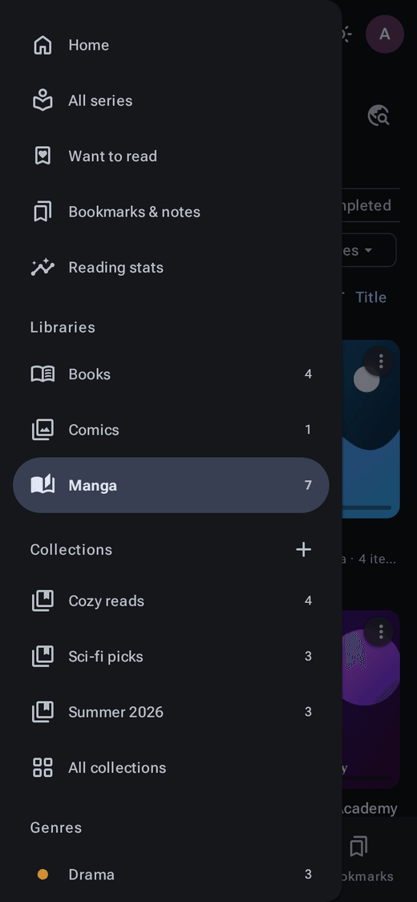</td>
<td>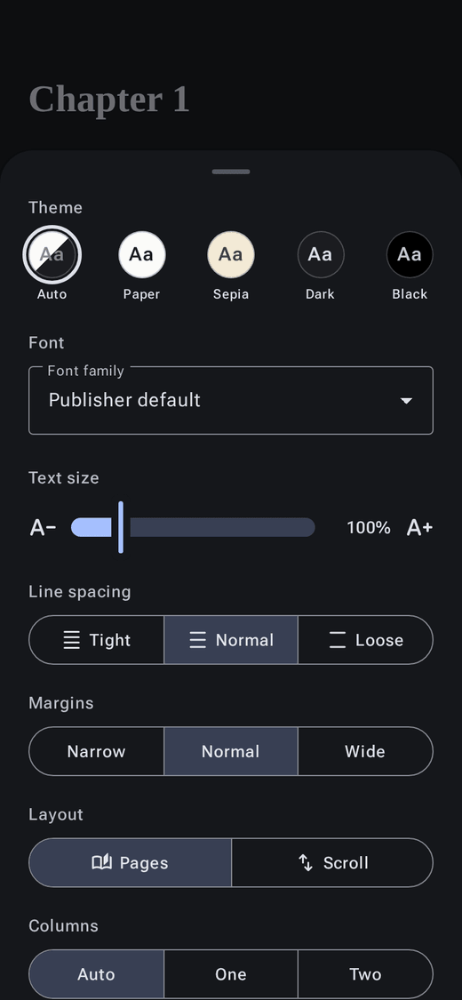</td>
</tr>
</table>

<details>
<summary><b>More screenshots</b></summary>

| | |
|---|---|
| 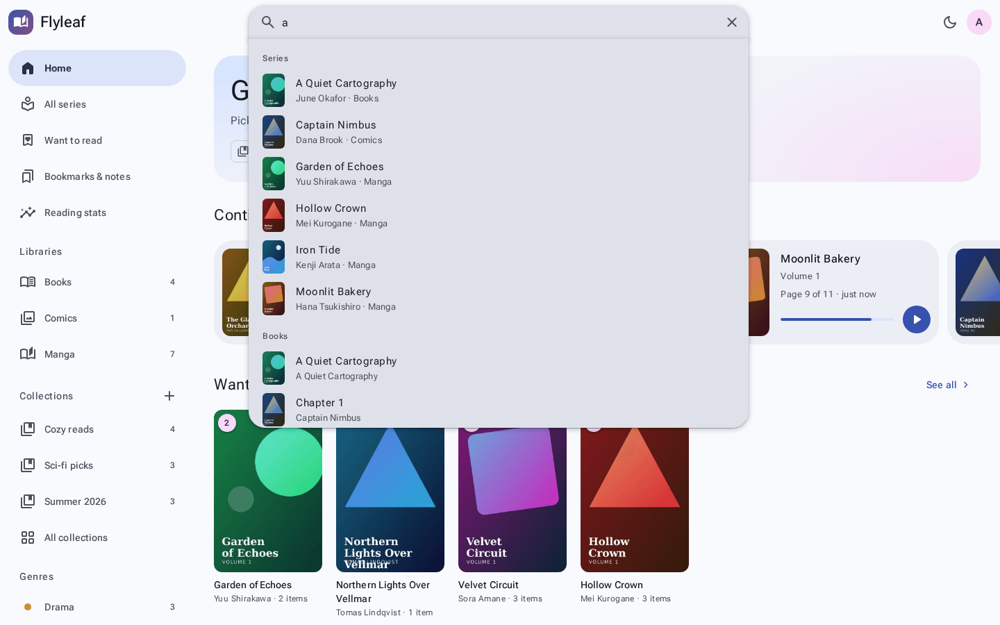 | 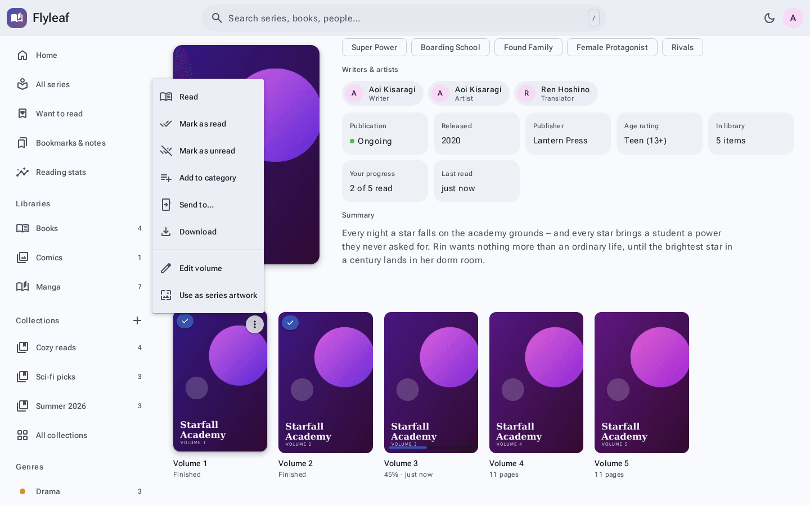 |
| 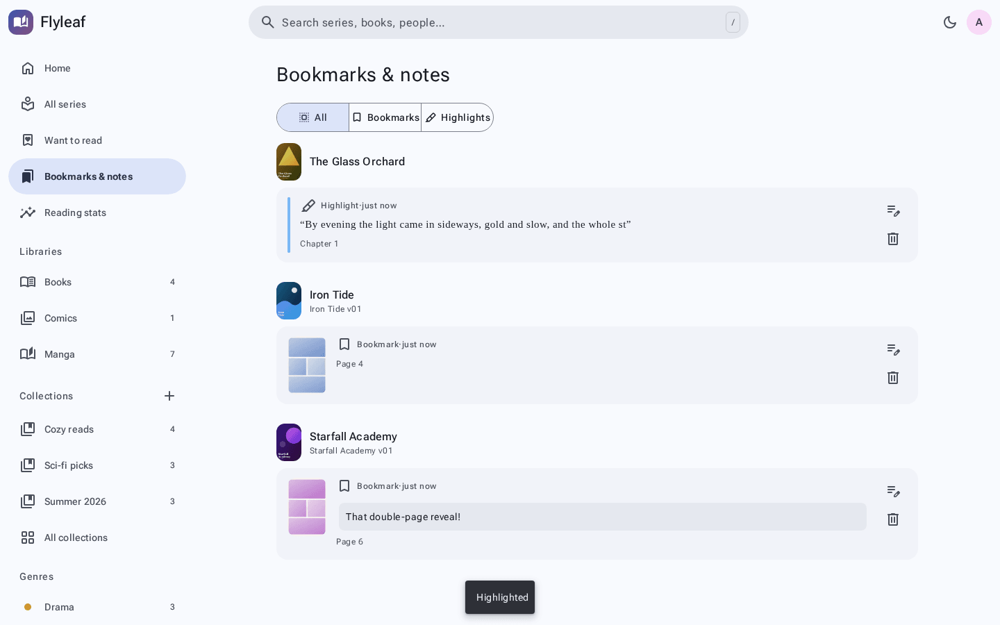 | 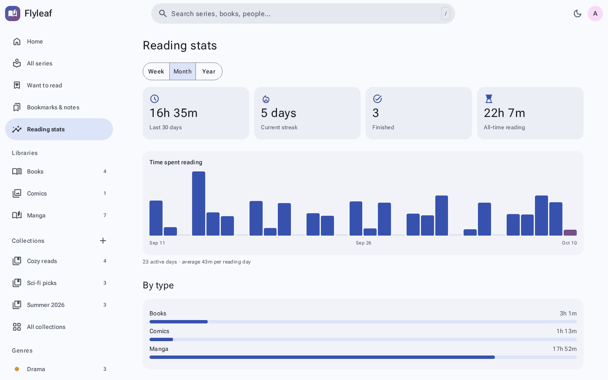 |
| 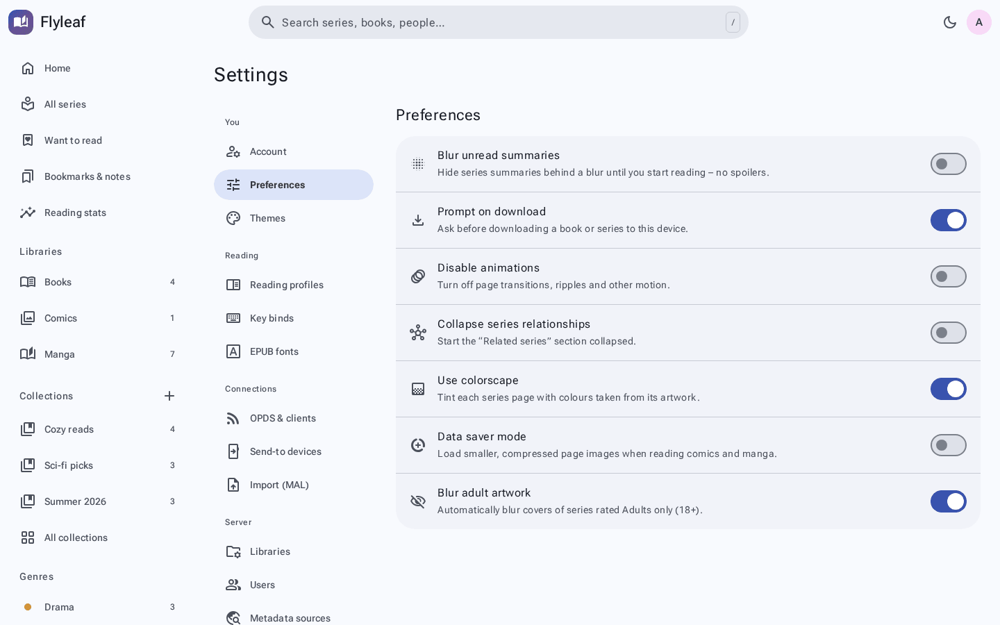 | 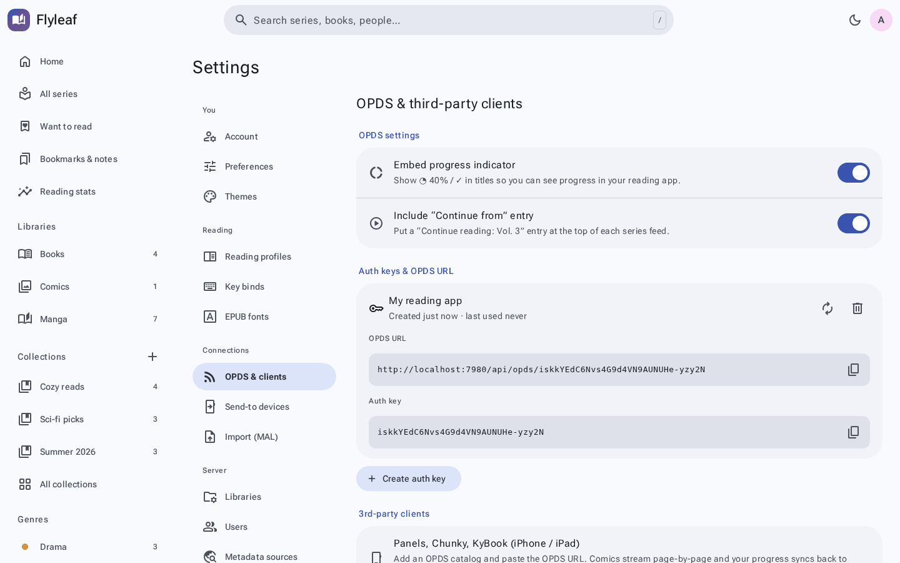 |
|  | 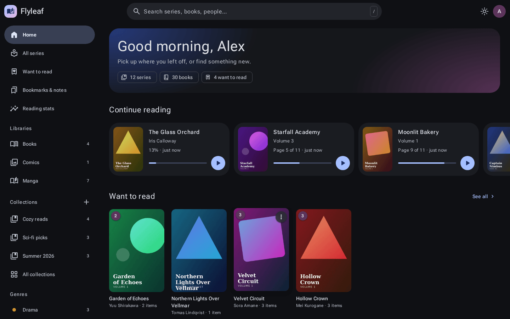 |

</details>

> The screenshots use a generated demo library – the series, authors and covers are made up.

---

## 🚀 Installation

### Option 1 — One-command install (recommended)

Works on **Fedora / RHEL**, **Debian / Ubuntu** and **Arch** (plus derivatives). It installs everything, sets up a **systemd service that starts on boot**, and prints the address to open.

```bash
git clone https://github.com/niruxx/Flyleaf.git
cd Flyleaf
sudo ./install.sh
```

Then open **http://localhost:7878** (or `http://<server-ip>:7878` from your phone) and create your admin account.

<details>
<summary><b>What install.sh does</b></summary>

| Step | Details |
|---|---|
| 📦 Packages | `git`, `curl`, `tar`/`xz` via **dnf**, **apt** or **pacman** |
| 🟢 Node.js | Uses the system Node if it's ≥ 22.13, otherwise downloads the official build (checksum-verified) to `/opt/flyleaf-runtime` |
| 📁 App | A git checkout in `/opt/flyleaf` (so `update.sh` can pull updates) |
| 💾 Data | Database, covers and logs in `/var/lib/flyleaf` – kept separate from the code |
| ⚙️ Config | `/etc/flyleaf/flyleaf.env` |
| 🔁 Service | `flyleaf.service`, enabled at boot, runs as **the user who ran sudo** so it can read your home folders |
| 🔥 Firewall | Optionally opens the port in `firewalld` or `ufw` |
| 🧰 CLI | A `flyleaf` command: `status`, `logs`, `restart`, `update`, `reset-password`, `uninstall` |
| 🧾 Manifest | Everything is recorded in `/etc/flyleaf/install.manifest` for a clean uninstall |

Options: `--port 8080`, `--user someone`, `--dir /srv/flyleaf`, `--data /srv/flyleaf-data`, `--yes` (no prompts).

</details>

### Option 2 — Run it yourself

Requires **Node.js 22.13 or newer**.

```bash
git clone https://github.com/niruxx/Flyleaf.git
cd Flyleaf
npm install
npm start          # → http://localhost:7878
```

### 🔄 Updating

```bash
flyleaf update        # installed with install.sh (same as: sudo /opt/flyleaf/update.sh)
./update.sh           # a manual checkout
```

`update.sh` pulls the latest code, backs up the database first (the last five backups are kept in the data folder under `backups/`), reinstalls dependencies and restarts the service. If anything fails it rolls back to the previous version. Your database, covers and settings are never touched.

### 🗑️ Uninstalling

```bash
flyleaf uninstall                             # asks before deleting your data
sudo /opt/flyleaf/uninstall.sh --keep-data    # keep the database & covers
```

This removes the service, app files, Node runtime, config, firewall rule and system user created by the installer. It asks before removing packages the installer added. **Your book folders are never touched.**

---

## ⚙️ Configuration

### Environment

Set these in `/etc/flyleaf/flyleaf.env` (service install) or a `.env` file next to `package.json` (manual), then restart.

| Variable | Default | Description |
|---|---|---|
| `PORT` | `7878` | Port to listen on |
| `HOST` | `0.0.0.0` | Interface to bind (`127.0.0.1` = this machine only) |
| `FLYLEAF_DATA_DIR` | `./data` | Database, covers, caches and logs |
| `SCAN_INTERVAL_MINUTES` | `60` | Automatic rescans (`0` = only on start / manual) |
| `SESSION_DAYS` | `30` | How long sign-ins last |
| `TRUST_PROXY` | `false` | Set to `true` behind an HTTPS reverse proxy |
| `SECURE_COOKIES` | `false` | Set to `true` when served over HTTPS |
| `LOG_LEVEL` | `info` | Terminal verbosity: `debug`, `info`, `warn`, `error` |

> 🤫 **Quiet console.** The terminal only shows one line per scan and real errors. Everything else (unreadable files, metadata lookups, library noise) goes to `data/logs/flyleaf.log`.

### 📁 Libraries & folder structure

Add libraries in **Settings → Libraries**, using the built-in folder browser or by pasting a path. Pick the type (Books, Manga, Comics) and how series are detected:

<table>
<tr><th>🔤 Kavita style – file names</th><th>📂 Komga style – folders</th></tr>
<tr><td>

Series, volume and chapter come from the **file name** and embedded metadata. Folders don't matter.

```text
Manga/
├── One Piece v01.cbz
├── One Piece v02 (2003) [Group].cbz
├── Berserk - c372.cbr
└── random folder/
    └── Spy x Family 012.cbz
```
→ *One Piece* (2 vols), *Berserk*, *Spy x Family*

</td><td>

Every folder that contains books is **one series**, named after the folder. Nothing to parse and nothing to edit.

```text
Manga/
├── One Piece/
│   ├── 001.cbz
│   └── 002.cbz
└── Solo Leveling/
    ├── Chapter 1/   (images)
    └── Chapter 2/   (images)
```
→ *One Piece*, *Solo Leveling*

</td></tr>
</table>

Ebook libraries default to Kavita style (series from EPUB/Calibre metadata). Comics and manga default to Komga style. You can switch at any time and Flyleaf regroups on the next scan.

### 🔎 Metadata sources

| Source | Best for | Key needed? |
|---|---|---|
| **AniList** | Manga, light novels | No |
| **MangaDex** | Manga (lots of external links) | No |
| **MyAnimeList** | Manga | No (uses Jikan) · optional official Client ID |
| **MangaUpdates** | Manga, manhwa, manhua | No |
| **ComicVine** | Western comics | Yes – free at [comicvine.gamespot.com/api](https://comicvine.gamespot.com/api/) |
| **Open Library** | Books | No |
| **Google Books** | Books | Optional (avoids shared rate limits) |

- **Manual:** on a series page, open **Edit ▾ → Fetch metadata online**, pick a result and tick the fields to apply.
- **Automatic:** in **Settings → Libraries → Edit**, enable *Automatically fetch metadata & artwork*. Only confident title matches are applied.
- Anything you edit by hand is **locked**, so scans and auto-matching never overwrite it.

### 📡 OPDS & reading apps

1. **Settings → OPDS & clients → Create auth key**
2. Copy the **OPDS URL**: `https://your-server/api/opds/<key>`
3. Add it as a catalog in **Panels**, **Chunky**, **KOReader**, **Moon+ Reader**, **Thorium**…

Comics stream page-by-page (OPDS-PSE) and your position syncs back to Flyleaf. Toggle **Embed progress indicator** and **Include "Continue from" entry** to taste. Set a **Public URL** in *Settings → Server* if you use a domain.

### 📧 Send to Kindle / Kobo

1. Admin: **Settings → Server & email** – add SMTP details (Gmail app password, Fastmail, your provider…) and send a test.
2. Each user: **Settings → Send-to devices** – add your `@kindle.com` address.
3. For Kindle, approve the *From* address in Amazon's **Personal Document Settings**.

Then use **⋮ → Send to…** on any book or series.

### 👥 Users & sharing outside your network

- The first visit creates the **admin**. Add **guests** in *Settings → Users*. Guests can read, bookmark, highlight and keep their own progress, collections and stats, but can't change libraries, metadata or other users.
- Set an **age restriction** per guest (Everyone / 13+ / 17+ / 18+).
- To share over the internet, **port-forward** the Flyleaf port on your router, or better, put it behind **HTTPS**:

```bash
# Caddy – automatic HTTPS
caddy reverse-proxy --from books.example.com --to localhost:7878
```

<details>
<summary>nginx example</summary>

```nginx
server {
  server_name books.example.com;
  client_max_body_size 50m;
  location / {
    proxy_pass http://127.0.0.1:7878;
    proxy_set_header Host $host;
    proxy_set_header X-Forwarded-For $proxy_add_x_forwarded_for;
    proxy_set_header X-Forwarded-Proto $scheme;
  }
  # listen 443 ssl; … (certbot)
}
```
</details>

Then set `TRUST_PROXY=true` and `SECURE_COOKIES=true`. Cloudflare Tunnel and Tailscale Funnel work too.

🔒 Built in: scrypt password hashing, HttpOnly SameSite cookies, CSRF protection, login rate limiting, and server-side read-only enforcement for guests.

### 📱 iPhone & Android

Open Flyleaf in **Safari**, then tap **Share → Add to Home Screen**. It launches full-screen with its own icon, keeps the screen awake while you read and respects the notch. On Android, use *Install app* in Chrome. Offline app-shell caching needs HTTPS. Everything else works over plain HTTP on your LAN.

---

## 🧰 Troubleshooting

| Problem | Fix |
|---|---|
| A library shows **0 items** | The service user must be able to read the folder: `sudo -u <user> ls /path/to/library` |
| **Port already in use** | Change `PORT` in the config and restart |
| **Forgot the admin password** | `flyleaf reset-password admin 'new-password'` (manual install: `npm run reset-password -- admin 'new-password'`) |
| Service status / logs | `flyleaf status` · `flyleaf logs` · `/var/lib/flyleaf/logs/flyleaf.log` |
| A file won't open | Check the log. Damaged archives are skipped during scans and listed there. |
| Metadata source errors | Some sources rate-limit. Wait a minute or add an API key in *Settings → Metadata sources*. |

---

## 🛠️ Under the hood

- **Server:** Node.js + Express 5, built-in `node:sqlite` (no native database to compile), `sharp` for thumbnails
- **Front end:** plain ES modules, no build step, hand-built Material 3 design tokens (OKLCH)
- **Readers:** [foliate-js](https://github.com/johnfactotum/foliate-js) for EPUB/MOBI/FB2, [pdf.js](https://mozilla.github.io/pdf.js/) for PDF, and a custom engine for comics and webtoons
- **Archives:** yauzl (zip), node-unrar-js (rar), 7-Zip (7z), node-tar (tar)

```text
server/          API, scanner, metadata providers, OPDS
public/          the web app (no build step)
  css/           Material 3 tokens, layout, reader
  js/views/      pages
  js/reader/     page & text engines, tracker
install.sh       update.sh       uninstall.sh
```

## 🙏 Credits

[foliate-js](https://github.com/johnfactotum/foliate-js) (MIT) · [pdf.js](https://github.com/mozilla/pdf.js) (Apache 2.0) · [Material Symbols](https://fonts.google.com/icons) (Apache 2.0) · [Roboto Flex, Literata, Merriweather, Atkinson Hyperlegible, OpenDyslexic](https://fontsource.org) (OFL) · metadata from AniList, MangaDex, MyAnimeList/Jikan, MangaUpdates, ComicVine, Open Library and Google Books.

<div align="center">

Made with 📖 and ☕ · MIT licensed

</div>
